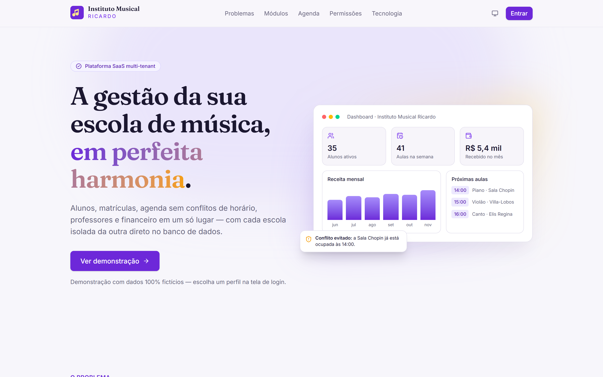
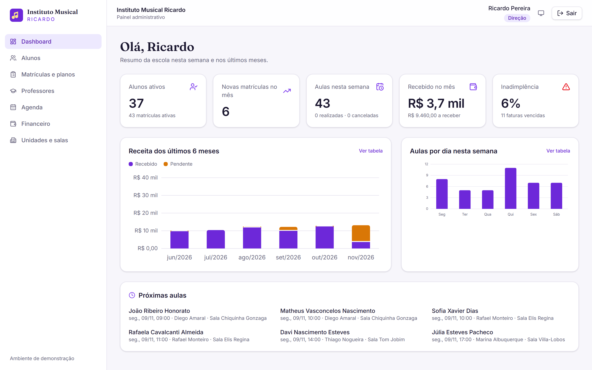
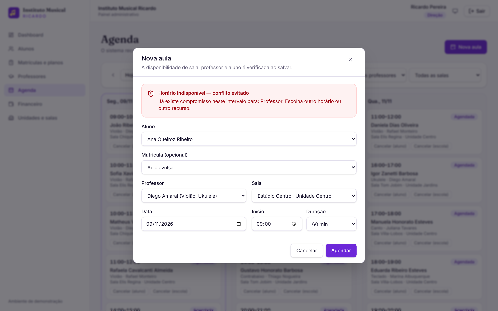
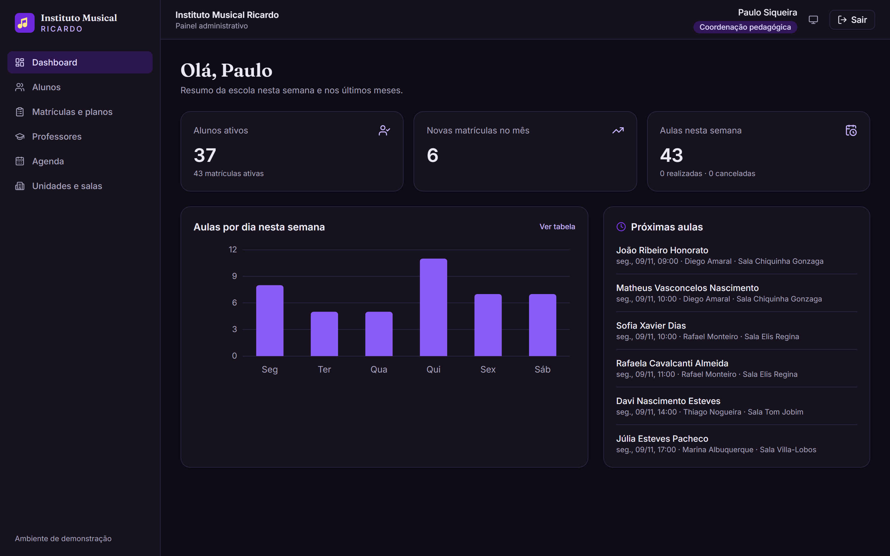
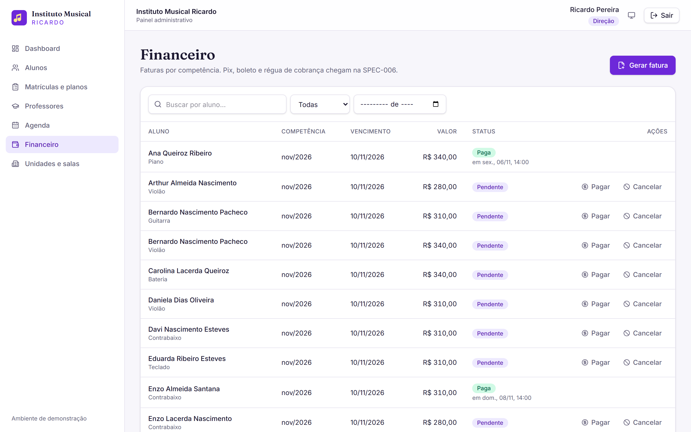
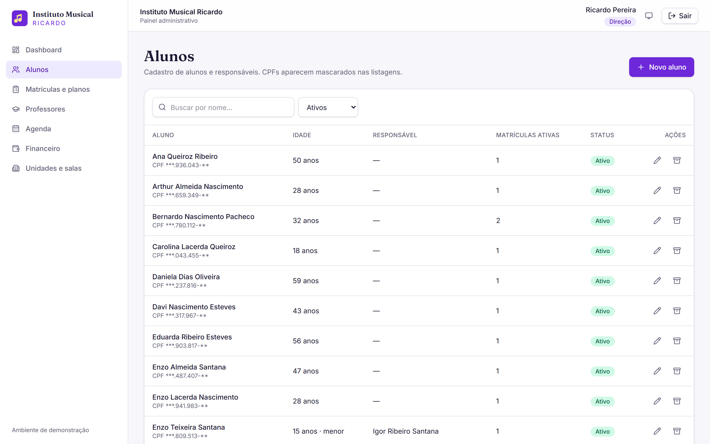
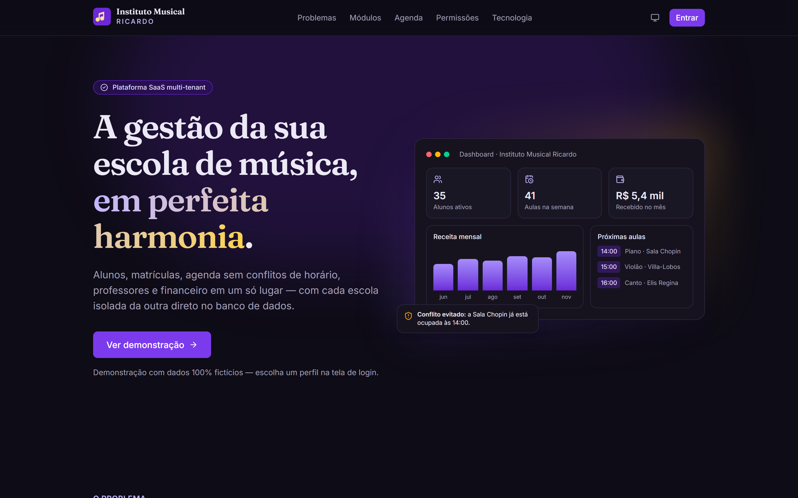
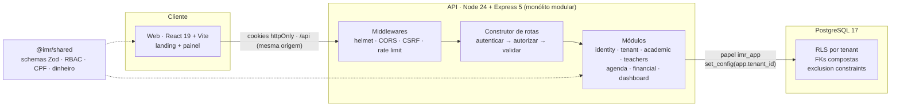

https://github.com/user-attachments/assets/083d12e0-71e7-4f4b-b6dc-5867e4219144


<div align="center">

# 🎵 Instituto Musical Ricardo

**Plataforma SaaS multi-tenant de gestão para escolas de música**

Alunos, matrículas, agenda sem conflitos de horário, professores e financeiro em um só lugar —
com cada escola isolada da outra direto no banco de dados.

[](https://github.com/ricardodatadev/music-manager-erp/actions/workflows/ci.yml)
[](https://github.com/ricardodatadev/music-manager-erp/actions/workflows/codeql.yml)


[](LICENSE)

</div>

<p align="center">
  
</p>

## Capturas de tela

|                                                           Dashboard (Direção)                                                           |                                                      Conflito de agenda evitado                                                      |
| :-------------------------------------------------------------------------------------------------------------------------------------: | :----------------------------------------------------------------------------------------------------------------------------------: |
|              |  |
|                                         **Coordenação no tema escuro — sem dados financeiros**                                          |                                                            **Financeiro**                                                            |
|  |                        |
|                                                       **Alunos (CPF mascarado)**                                                        |                                                   **Landing page no tema escuro**                                                    |
|                            |                                                      |

> As capturas são geradas automaticamente com `npm run capturas` (Playwright), a partir dos
> dados fictícios do seed.

---

## Sobre o projeto

Escolas de música que crescem esbarram sempre nos mesmos problemas: reagendamentos pelo WhatsApp
que geram choque de horários, repasse de professores calculado em planilha, inadimplência sem
controle e evasão percebida tarde demais.

Este projeto é uma plataforma **SaaS B2B multi-tenant** para resolver isso. A primeira versão
(SPEC-001) foi construída com uma regra clara: **funcionalidades enxutas, fundação rigorosa**.
Segurança, isolamento de dados, testes e arquitetura vieram antes das telas — para que as
próximas versões apenas aprofundem os módulos, sem reescrever a base.

> 💡 Todo o desenvolvimento é **guiado por especificações**: requisitos ([SRS](docs/specs/especificacao_requisitos.md)),
> stack ([especificação](docs/specs/especificacao_stack.md)) e um plano de implementação com
> decisões de arquitetura e checklist ([SPEC-001](docs/specs/SPEC-001-fundacao-e-vitrine.md)).

## Funcionalidades

| Módulo                  | Disponível nesta versão                                                                                             | Próximas specs                                   |
| :---------------------- | :------------------------------------------------------------------------------------------------------------------ | :----------------------------------------------- |
| **Alunos & Matrículas** | Cadastro com responsável obrigatório para menores; planos mensal/semestral/anual; trancar, reativar e cancelar      | Contrato eletrônico com OTP, aulas experimentais |
| **Agenda & Salas**      | Agenda semanal com **motor anti-overbooking** (sala, professor e aluno); cancelar matrícula libera horários futuros | Grade recorrente, reposição self-service         |
| **Professores**         | Instrumentos, regime PJ hora/aula, percentual ou CLT; arquivamento sem perder histórico                             | Apuração automática da folha                     |
| **Financeiro**          | Faturas por competência, pagamento, cancelamento e status "vencida" automático                                      | Pix/boleto, régua de cobrança, DRE               |
| **Dashboard**           | Indicadores e gráficos que respeitam o perfil de quem acessa                                                        | —                                                |
| **Multi-tenant & RBAC** | Isolamento por Row-Level Security, 4 perfis com permissões por módulo                                               | Gerente de unidade, SuperAdmin, portais          |

## Destaques de engenharia

### 🔒 Multi-tenant de verdade — o banco recusa vazamentos

O `tenant_id` é filtrado na aplicação **e** pelo PostgreSQL com **Row-Level Security**. A API
conecta com um papel sem superusuário e sem `BYPASSRLS`; sem tenant definido na transação,
nenhuma linha é visível (_fail-closed_).

Um detalhe pouco lembrado: o Postgres verifica chaves estrangeiras **ignorando o RLS**. Com FKs
simples, quem conhecesse o UUID de uma unidade de outra escola poderia referenciá-la. Por isso
todas as FKs são **compostas** `(id, tenant_id)`.

### 📅 Overbooking impossível — não apenas improvável

A abordagem comum (`SELECT ... FOR UPDATE` antes do `INSERT`) **falha quando ainda não existe
linha conflitante**: duas requisições simultâneas passam. Aqui a regra é garantida pelo próprio
banco com _exclusion constraints_:

```sql
CONSTRAINT ex_aulas_sala EXCLUDE USING gist (
  sala_id WITH =, tstzrange(data_inicio, data_fim, '[)') WITH &&
) WHERE (status NOT IN ('CANCELADA_ALUNO', 'CANCELADA_ESCOLA'))
-- idem para professor_id e aluno_id
```

Um teste dispara 6 agendamentos simultâneos para o mesmo horário: exatamente 1 é gravado. A API
ainda faz uma pré-checagem para responder **qual** recurso está ocupado (`409 CONFLITO_AGENDA`).

### 🛡️ Sessão e API seguras por padrão

- Senhas com **Argon2id**; login com resposta e tempo uniformes (sem enumeração de contas).
- Cookies `httpOnly` + `SameSite=Strict`; **refresh token rotativo com detecção de reuso**
  (token reapresentado revoga toda a família de sessões) e revogação imediata no logout.
- CSP `default-src 'none'` na API e CSP restritiva no frontend; proteção CSRF; CORS por origem
  exata; rate limiting por IP e por conta.
- Toda rota protegida declara sua permissão — **uma rota sem permissão não compila**. Entradas
  validadas por schemas Zod compartilhados entre API e Web; campos extras são rejeitados.
- CPF mascarado nas listagens, logs com _redaction_, erros sem stack trace nem SQL.

Os 15 requisitos de segurança e onde cada um é testado estão na
[seção 4 da SPEC-001](docs/specs/SPEC-001-fundacao-e-vitrine.md#4-requisitos-de-segurança-obrigatórios-nesta-spec).

### ✅ Qualidade verificável

**294 testes automatizados** (Vitest + Supertest + Testing Library), incluindo isolamento entre
escolas, RBAC por perfil × endpoint, concorrência na agenda, rotação de tokens, migrations com
checksum e sincronia entre o schema do ORM e o banco real. CI com lint, typecheck, testes contra
PostgreSQL, build, `npm audit`, CodeQL e Dependabot.

## Arquitetura



| Camada    | Tecnologias                                                                          |
| :-------- | :----------------------------------------------------------------------------------- |
| Backend   | Node.js 24, TypeScript estrito, Express 5, Drizzle ORM, Zod, pino, jose, Argon2      |
| Banco     | PostgreSQL 17 (RLS, `btree_gist`, exclusion constraints), migrations SQL versionadas |
| Frontend  | React 19, Vite 8, Tailwind CSS 4, React Router, TanStack Query, React Hook Form      |
| Qualidade | Vitest, Supertest, Testing Library, ESLint (type-checked), Prettier                  |
| Infra     | Docker Compose, GitHub Actions, CodeQL, Dependabot                                   |

## Como executar

**Pré-requisitos:** Node.js 24+ e Docker.

```bash
npm install          # dependências do monorepo
npm run setup:env    # gera o .env com segredos aleatórios (nunca versionado)
npm run db:up        # sobe o PostgreSQL (dev e testes) em 127.0.0.1
npm run db:setup     # aplica as migrations e carrega os dados de demonstração
npm run dev          # API em :3333 e Web em http://localhost:5173
```

### Contas de demonstração

Escola: `instituto-ricardo` · Senha de todas: `Demo@2026!` · Dados **100% fictícios**.

| Perfil      | E-mail                                  | O que muda                    |
| :---------- | :-------------------------------------- | :---------------------------- |
| Direção     | `admin@instituto-ricardo.example`       | Acesso completo               |
| Secretaria  | `secretaria@instituto-ricardo.example`  | Operação do dia a dia         |
| Coordenação | `coordenacao@instituto-ricardo.example` | Sem acesso ao financeiro      |
| Financeiro  | `financeiro@instituto-ricardo.example`  | Faturas e receita; sem agenda |

> Existe também uma segunda escola (`escola-sonora`, `admin@escola-sonora.example`) para
> demonstrar o isolamento: nenhum dado de uma aparece na outra.

### Scripts úteis

| Comando                              | Descrição                                                           |
| :----------------------------------- | :------------------------------------------------------------------ |
| `npm test`                           | Todos os testes (requer `npm run db:up`)                            |
| `npm run lint` · `npm run typecheck` | Qualidade estática                                                  |
| `npm run build`                      | Build de produção (API + Web)                                       |
| `npm run db:reset`                   | Recria o banco de desenvolvimento do zero (bloqueado em produção)   |
| `npm run audit`                      | Auditoria de dependências                                           |
| `npm run capturas`                   | Regera as capturas de tela do README (requer `npm run dev` rodando) |

## Estrutura

```text
apps/
  api/        API REST — módulos, middlewares, migrations SQL, seed e testes
  web/        Landing page + painel administrativo
packages/
  shared/     Contratos compartilhados: schemas Zod, enums, matriz RBAC, utilitários
docs/specs/   Requisitos, stack e specs de implementação
```

## Roadmap

| Spec        | Tema                                                                                |
| :---------- | :---------------------------------------------------------------------------------- |
| ✅ SPEC-001 | Fundação segura, cadastros, agenda anti-overbooking, financeiro essencial e vitrine |
| SPEC-002    | Agenda avançada e reposição self-service                                            |
| SPEC-003    | Portal do professor: chamada em 1 clique e diário de classe                         |
| SPEC-004    | Matrícula digital com contrato eletrônico                                           |
| SPEC-005    | DRE, contas a pagar e folha docente                                                 |
| SPEC-006    | Pix, boleto, webhooks e régua de cobrança (Redis + BullMQ)                          |
| SPEC-007    | Portal do aluno e ferramentas de LGPD                                               |
| SPEC-008    | Multi-unidade, SuperAdmin, Nginx/TLS e deploy                                       |

## Segurança

Encontrou uma vulnerabilidade? Veja a [política de segurança](SECURITY.md) — por favor, não
abra issues públicas para isso.

## Licença e autoria

Distribuído sob a [licença MIT](LICENSE). Projeto de portfólio desenvolvido por **Ricardo Pereira**.
