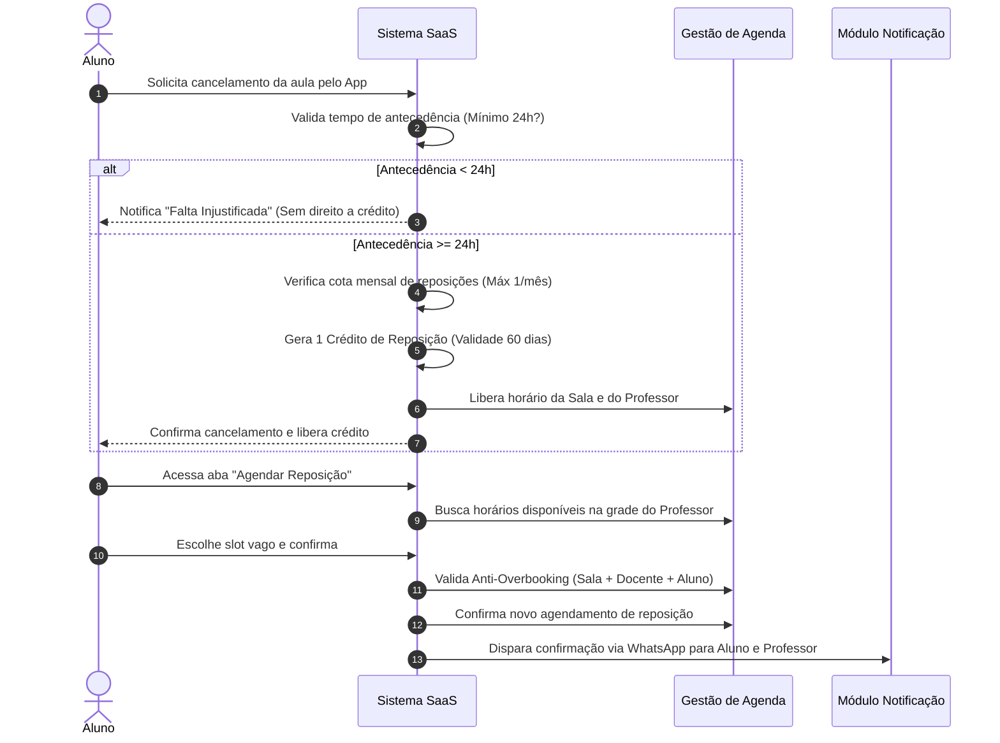
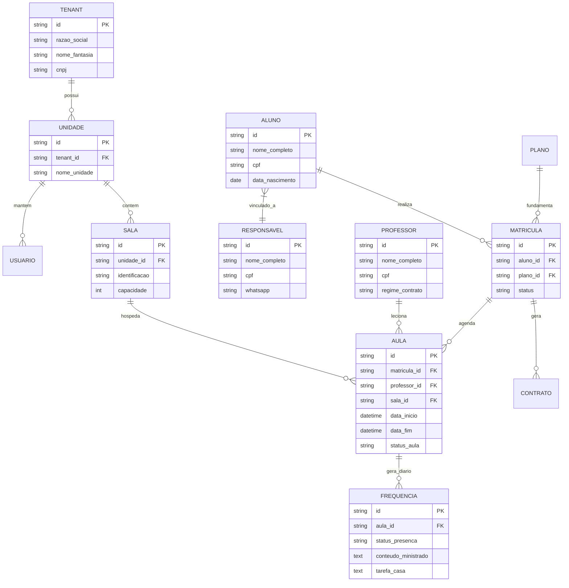

# ESPECIFICAÇÃO DE REQUISITOS DE SOFTWARE (SRS)
## Sistema de Gestão para Escola de Música — Plataforma SaaS Multi-Tenant (Instituto Musical Ricardo)

---

## 1. INTRODUÇÃO

### 1.1 Objetivo do Documento
Este documento tem como objetivo apresentar a especificação técnica, funcional e arquitetural detalhada do software de gestão para escolas de música, tomando como referência a unidade piloto **Instituto Musical Ricardo**. O documento serve como contrato de escopo e referência de engenharia para desenvolvedores, arquitetos de software, engenheiros de QA, designers UX/UI, Product Owners e administradores do negócio.

### 1.2 Escopo do Projeto
O sistema abrange a automação e gestão completa das operações administrativas, pedagógicas e financeiras de uma escola de música. A arquitetura é concebida nativamente como **SaaS Multi-Tenant (B2B)**, permitindo o isolamento de dados por instituição contratante, suporte a múltiplas unidades físicas por escola, acesso unificado pela direção (HQ), além de portais dedicados para professores, alunos e seus respectivos responsáveis financeiros/legais.

### 1.3 Público-Alvo
* **Equipe de Desenvolvimento e Arquitetura:** Para implementação das APIs, interfaces web/mobile e estruturas de persistência.
* **Equipe de Testes e Qualidade (QA):** Para elaboração dos planos de testes unitários, de integração, e2e e aceitação.
* **Designers UX/UI:** Para construção dos protótipos de baixa e alta fidelidade (interfaces mobile-first e rotinas de alta densidade administrativa).
* **Gestores e Stakeholders:** Para validação das regras de negócio, fluxos operacionais e governança do produto.

### 1.4 Convenções Utilizadas
* **RF:** Requisito Funcional.
* **RNF:** Requisito Não Funcional.
* **RN:** Regra de Negócio.
* **Priorização (MoSCoW):**
  * **Must Have:** Funcionalidade essencial para o MVP / lançamento inicial.
  * **Should Have:** Funcionalidade de alta importância, programada para releases de expansão.
  * **Could Have:** Funcionalidade desejável que adiciona valor diferencial.
  * **Won't Have:** Escopo diferido para versões futuras.

---

## 2. VISÃO GERAL DO SISTEMA

### 2.1 Contexto do Negócio
O Instituto Musical Ricardo atua há 8 anos no ensino musical. Com 2 unidades físicas próprias e demanda crescente por expansão via franquias, a operação enfrenta desafios operacionais devido ao uso de processos manuais (planilhas, agendas físicas, conversas em WhatsApp e anotações descentralizadas).

### 2.2 Problemas Identificados
1. **Gargalo no Reagendamento de Aulas:** Trocas manuais de horários via mensagens diretas gerando conflitos de agenda, subaproveitamento de salas e sobrecarga da secretaria.
2. **Complexidade no Cálculo de Repasse Docente:** Dificuldade para apurar a folha de pagamento de professores contratados sob diferentes regimes (PJ por hora/aula, porcentagem ou CLT), considerando faltas, cancelamentos e reposições.
3. **Inadimplência e Baixas Manuais:** Falta de automação no envio de cobranças e conciliação bancária manual de boletos e transferências.
4. **Falta de Rastreabilidade Pedagógica:** Ausência de acompanhamento centralizado do histórico de aprendizado dos estudantes e falha no engajamento preventivo à evasão (churn).

### 2.3 Objetivos do Sistema
* **Zerar o Retrabalho da Secretaria:** Promover o autosserviço de reagendamento e a matrícula digital.
* **Reduzir a Evasão (Churn):** Manter a taxa de cancelamento mensal abaixo de $3\%$.
* **Garantir Acurácia Financeira:** Automatizar a cobrança recorrente e a apuração da folha de professores.
* **Prover Visibilidade Gerencial:** Oferecer relatórios estratégicos e indicadores DRE em tempo real.

---

## 3. STAKEHOLDERS E ATORES

### 3.1 Perfis de Usuários
1. **SuperAdmin (Dono do SaaS):** Administrador da plataforma multi-tenant. Gerencia assinaturas, libera módulos e monitora a saúde das escolas contratantes.
2. **Admin / Diretor da Escola:** Acesso irrestrito a todas as unidades, relatórios financeiros globais, margens de lucro, DRE e configurações gerais.
3. **Gerente de Unidade:** Gestão operacional e financeira restrita à sua unidade física.
4. **Coordenador Pedagógico:** Gestão de turmas, ementas de instrumentos, diários de classe, avaliações pedagógicas e agendas de professores. Não visualiza o faturamento geral.
5. **Secretaria / Atendimento:** Operação diária, cadastro de alunos, emissão de faturas balcão, agendamentos e atendimento de solicitações.
6. **Financeiro:** Gestão de contas a pagar/receber, conciliação bancária, réguas de cobrança e notas fiscais.
7. **Professor:** Acesso à agenda individual, chamada digital (check-in), diário de classe, materiais e extrato demonstrativo de sua remuneração.
8. **Aluno / Responsável:** Acesso aos compromissos agendados, solicitação de reposição self-service, download de materiais, histórico financeiro e relatórios de progresso.

### 3.2 Matriz de Permissões (RBAC)

| Perfil / Módulo | Alunos & Matrículas | Agenda & Salas | Pedagógico | Financeiro / DRE | Extrato Professor | Configurações SaaS |
| :--- | :---: | :---: | :---: | :---: | :---: | :---: |
| **SuperAdmin** | Total | Total | Total | Total | Total | Total |
| **Admin / Diretor** | Total | Total | Total | Total | Total | Restrito |
| **Gerente de Unidade** | Unidade | Unidade | Unidade | Limitado | Unidade | Negação |
| **Coordenador** | Leitura | Leitura | Total | Negação | Negação | Negação |
| **Secretaria** | Operacional | Operacional | Leitura | Operacional | Negação | Negação |
| **Financeiro** | Leitura | Negação | Negação | Total | Negação | Negação |
| **Professor** | Próprios | Própria | Próprios | Negação | Próprio | Negação |
| **Aluno / Resp.** | Próprio | Própria | Próprio | Próprio | Negação | Negação |

---

## 4. REQUISITOS FUNCIONAIS (RF)

### 4.1 Módulo: Alunos e Matrículas

#### RF-001: Cadastro de Alunos e Responsáveis
* **Descrição:** Permitir o cadastramento dos dados cadastrais completos do aluno e de seus responsáveis legais/financeiros (quando menor de idade).
* **Ator:** Secretaria, Admin.
* **Pré-condição:** Autenticação no sistema.
* **Fluxo Principal:**
  1. O usuário acessa a opção "Novo Aluno".
  2. Informa dados pessoais (Nome, CPF, RG, Data de Nascimento, Endereço, Foto, WhatsApp, Histórico de Saúde).
  3. Caso o aluno seja menor de idade, o sistema exige o vínculo ou cadastramento de um Responsável Financeiro/Legal.
  4. O sistema valida o CPF e grava os dados.
* **Tratamento de Exceções:** CPF duplicado gera aviso impeditivo.
* **Critério de Aceite:** O sistema deve permitir vincular múltiplos alunos a um mesmo responsável financeiro.
* **Prioridade:** Must Have.

#### RF-002: Matrícula Digital e Contrato Eletrônico
* **Descrição:** Disponibilizar fluxo de contratação com geração de contrato e assinatura eletrônica com validade jurídica.
* **Ator:** Secretaria, Aluno/Responsável.
* **Fluxo Principal:**
  1. A secretaria gera uma proposta ou o aluno acessa o link de checkout.
  2. Seleciona a modalidade, o plano (Mensal, Semestral ou Anual) e a grade de horários.
  3. O contrato de prestação de serviços é gerado dinamicamente com base nas cláusulas padrão da escola.
  4. O responsável assina o documento eletronicamente via confirmação (OTP ou token por e-mail/WhatsApp).
  5. O contrato assinado é armazenado e a matrícula torna-se ativa.
* **Prioridade:** Must Have.

#### RF-003: Pipeline de Aulas Experimentais
* **Descrição:** Registrar e gerenciar a jornada de alunos potenciais desde o agendamento da aula demonstrativa até a conversão em matrícula.
* **Ator:** Secretaria.
* **Prioridade:** Must Have.

#### RF-004: Trancamento Temporário e Rescisão
* **Descrição:** Permitir a suspensão temporária do contrato ou o cancelamento definitivo, aplicando regras de liberação de horários na agenda do professor e cálculo automático de taxas/multas de fidelidade.
* **Ator:** Secretaria, Admin.
* **Prioridade:** Should Have.

---

### 4.2 Módulo: Professores e Remuneração

#### RF-005: Cadastro de Professores e Especialidades
* **Descrição:** Manter os dados dos docentes, qualificações musicais, vinculo contratual (PJ/MEI ou CLT) e instrumentos ministrados.
* **Ator:** Coordenador, Admin.
* **Prioridade:** Must Have.

#### RF-006: Diário de Classe e Chamada Digital
* **Descrição:** Interface para o docente registrar em tempo real a presença dos alunos e detalhar o conteúdo ministrado e tarefas para casa.
* **Ator:** Professor.
* **Pré-condição:** Aula presente na agenda da data corrente.
* **Fluxo Principal:**
  1. O professor acessa a visão do dia no mobile.
  2. Seleciona a aula e clica em "Registrar Presença".
  3. Marca o status: `Presente`, `Falta Justificada`, `Falta Injustificada` ou `Aula Cancelada pela Escola`.
  4. Preenche os campos de texto: "Conteúdo Ministrado" e "Tarefa para Casa".
  5. Confirma o envio em até 1 clique para a presença.
* **Prioridade:** Must Have.

#### RF-007: Apuração da Folha de Remuneração Docente
* **Descrição:** Consolidar ao final do ciclo os valores devidos a cada professor com base em suas aulas ministradas e modelo contratual pactuado (porcentagem, hora/aula fixa ou CLT).
* **Ator:** Financeiro, Admin.
* **Prioridade:** Must Have.

---

### 4.3 Módulo: Agenda, Salas e Aulas

#### RF-008: Motor Anti-Overbooking de Agendamento
* **Descrição:** Validar e impedir o choque de horários na alocação de compromissos.
* **Ator:** Sistema (Motor Automático), Secretaria.
* **Regra de Validação:** Antes de gravar qualquer agendamento, o sistema verifica a indisponibilidade simultânea da **Sala Física**, do **Professor** e do **Aluno**. Se qualquer uma das 3 entidades possuir um compromisso no mesmo intervalo de tempo, o agendamento é bloqueado.
* **Prioridade:** Must Have.

#### RF-009: Reagendamento e Reposição Self-Service
* **Descrição:** Permitir que o aluno cancele sua aula pelo aplicativo/portal e escolha de forma autônoma um novo horário para a reposição.
* **Ator:** Aluno / Responsável.
* **Fluxo Principal:**
  1. O aluno seleciona uma aula futura e clica em "Cancelar Aula".
  2. O sistema valida se o cancelamento cumpre a antecedência mínima estipulada em regra de negócio (ex: 24 horas).
  3. Atendendo ao requisito, o sistema gera 1 "Crédito de Reposição" (com validade de 60 dias) e libera a sala/docente.
  4. O aluno abre a tela "Agendar Reposição", visualiza os slots vagos no perfil do seu professor e confirma o novo horário.
* **Prioridade:** Must Have.

---

### 4.4 Módulo: Financeiro e Faturamento

#### RF-010: Faturamento Recorrente e Gateway de Pagamento
* **Descrição:** Gerar lotes mensais de cobrança via Pix Dinâmico, Boleto Bancário e Cartão de Crédito recorrente via integração nativa por API.
* **Ator:** Sistema (Job Automático), Financeiro.
* **Prioridade:** Must Have.

#### RF-011: Régua de Cobrança Automática
* **Descrição:** Disparar notificações e lembretes de faturas por e-mail e WhatsApp API em datas estratégicas ($D-5$, $D-0$, $D+3$, $D+10$).
* **Ator:** Sistema.
* **Prioridade:** Must Have.

#### RF-012: Gestão de Contas a Pagar e DRE Operacional
* **Descrição:** Registro de despesas fixas/variáveis e geração automatizada do Demonstrativo do Resultado do Exercício por regime de caixa e competência.
* **Ator:** Financeiro, Admin.
* **Prioridade:** Must Have.

---

## 5. REQUISITOS NÃO FUNCIONAIS (RNF)

### RNF-001: Segurança e Criptografia
* **Categoria:** Segurança.
* **Descrição:** Todos os dados trafegados entre os clientes e o servidor devem utilizar protocolo TLS 1.3 (HTTPS). Dados sensíveis em repouso (como senhas e tokens de API) devem ser criptografados utilizando hash bcrypt ou algoritmo AES-256.
* **Prioridade:** Must Have.

### RNF-002: Arquitetura Multi-Tenant com Isolamento Lógico
* **Categoria:** Arquitetura.
* **Descrição:** O sistema deve garantir a segregação estrita dos dados de cada instituição parceira via filtragem obrigatoriamente vinculada a uma chave primária `tenant_id` em todas as consultas relacionais.
* **Prioridade:** Must Have.

### RNF-003: Conformidade com a LGPD
* **Categoria:** Privacidade.
* **Descrição:** Fornecer suporte aos direitos dos titulares de dados, incluindo solicitação de exportação de dados pessoais e anonimização/exclusão (Direito ao Esquecimento), resguardando prazos legais de retenção fiscal.
* **Prioridade:** Must Have.

### RNF-004: Tempo de Resposta (Desempenho)
* **Categoria:** Desempenho.
* **Descrição:** As requisições de consulta de agenda e carregamento de listas do diário de classe devem responder em um tempo $\le 1.5$ segundo para $95\%$ das chamadas sob carga normal de uso.
* **Prioridade:** Should Have.

### RNF-005: Disponibilidade e Uptime
* **Categoria:** Disponibilidade.
* **Descrição:** A plataforma SaaS deve manter SLA (Service Level Agreement) mínimo de $99,5\%$ de disponibilidade mensal.
* **Prioridade:** Must Have.

---

## 6. REGRAS DE NEGÓCIO (RN)

* **RN-001 - Prazo e Cotas de Reposição:** O cancelamento de aulas pelo aluno com direito a crédito exige aviso prévio mínimo de 24 horas. É concedido o limite máximo de 1 (uma) reposição por mês por contrato, com validade do crédito estipulada em 60 dias corridos.
* **RN-002 - Visibilidade Restrita de Remuneração:** O perfil do Professor tem acesso restrito a métricas financeiras globais da escola e ao valor exato pago pelo aluno em sua mensalidade, podendo visualizar unicamente os valores referentes aos seus repasses contratuais calculados.
* **RN-003 - Restrição Anti-Overbooking:** O sistema impedirá qualquer gravação de compromisso que gere alocação simultânea da mesma sala física, do mesmo docente ou do mesmo aluno no mesmo intervalo de horário.
* **RN-004 - Multa por Rescisão Antecipada:** Contratos vigentes sob planos com benefício de fidelidade (Semestral ou Anual) que solicitarem cancelamento antecipado sofrerão incidência de multa rescisória de $10\%$ calculada sobre o saldo financeiro remanescente.

---

## 7. PROCESSOS DE NEGÓCIO

### 7.1 Fluxo de Cancelamento e Reagendamento de Aula (Self-Service)

---

## 8. MODELAGEM CONCEITUAL DE DADOS

### 8.1 Diagrama Entidade-Relacionamento (ER)

---

## 9. INTEGRAÇÕES EXTERNAS

1. **Gateways de Pagamento (Asaas / Mercado Pago / Iugu):** Conexão via API REST para geração de cobranças (Pix dinâmico, boletos, cartão de crédito) e Webhooks para conciliação bancária e baixa automatizada.
2. **Provedores de WhatsApp API (Z-API / Evolution API):** Envio automatizado de réguas de cobrança, lembretes de compromisso e notificações de falta.
3. **Serviços de Emissão de Notas Fiscais (NFS-e):** Integração com motores fiscais municipais para emissão automatizada de notas fiscais de serviço.

---

## 10. REQUISITOS DE INTERFACE E NAVEGAÇÃO

* **Interfaces Mobile-First (Alunos e Professores):** Layout limpo e otimizado para dispositivos móveis, focado em agilidade para registro de presenças e consulta de horários em poucos toques.
* **Interfaces de Alta Densidade (Secretaria e Financeiro):** Telas otimizadas para navegadores desktop, com suporte a atalhos de teclado, filtros avançados, grids com paginação e visualização master de agendas.

---

## 11. ARQUITETURA PRELIMINAR

* **Modelo de Implantação:** SaaS Multi-Tenant com isolamento lógico via chave de partição (`tenant_id`).
* **Backend:** API RESTful estruturada em arquitetura modular (Node.js/TypeScript ou Python/FastAPI).
* **Frontend:** Aplicação Web Responsiva / PWA desenvolvida em React.js / Next.js.
* **Persistência:** Banco de dados relacional PostgreSQL para operações transacionais.

---

## 12. MATRIZ DE RASTREABILIDADE

| Necessidade de Negócio | Requisito Funcional | Regra de Negócio | Módulo Envolvido |
| :--- | :--- | :--- | :--- |
| Reduzir chamados de reagendamento | RF-009 | RN-001 | Agenda & Reposições |
| Garantir acurácia nos repasses docentes | RF-006, RF-007 | RN-002 | Professores & Remuneração |
| Eliminar overbooking de infraestrutura | RF-008 | RN-003 | Gestão de Salas & Agendas |
| Automação da cobrança e controle financeiro | RF-010, RF-011 | RN-004 | Financeiro & Faturamento |

---

## 13. RISCOS E DEPENDÊNCIAS

1. **Dependência de APIs de Terceiros:** Indisponibilidade de gateways de pagamento ou instabilidade no envio de mensagens via WhatsApp API pode impactar momentaneamente a régua de cobrança ou o envio de confirmações.
2. **Adoção Tecnológica pelos Docentes:** Risco de atraso no preenchimento dos diários de classe por parte de professores menos familiarizados com soluções digitais. *Mitigação: Treinamento e interface responsiva com operação em 1 clique.*

---

## 14. PENDÊNCIAS E QUESTÕES EM ABERTO

* **LAC-001:** Definir com a direção a regra exata de remuneração para professores contratados via PJ durante o período de recesso ou férias coletivas da escola.
* **LAC-002:** Homologar o fornecedor oficial de Gateway de Pagamentos para a fase piloto do sistema.

---

## 15. HISTÓRICO DE VERSÕES

| Versão | Data | Descrição da Alteração | Autor |
| :---: | :---: | :--- | :--- |
| 1.0.0 | 08/11/2026 | Consolidação inicial da Especificação de Requisitos de Software (SRS). | Arquiteto de Software / Especialista em Requisitos |